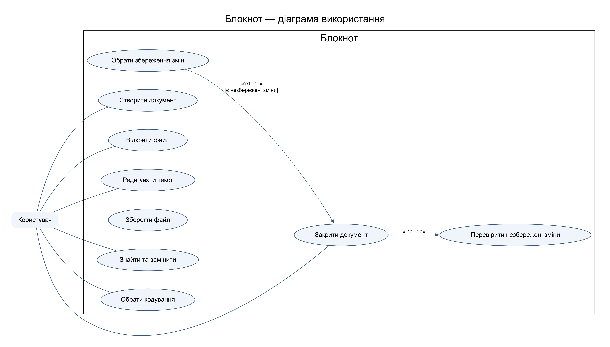

# Практична робота 6

## Аналіз і формалізація вимог до Блокнота

Предмет: Компоненти. Номер у списку: 14.

Обрано варіант 2. Мета — визначити перевірні вимоги до локального текстового редактора. Межі системи: створення, редагування, відкриття і збереження текстових файлів одним користувачем. Спільне редагування через мережу не входить до обсягу.

### Специфікація вимог

| ID | Тип і пріоритет | Вимога | Критерій приймання |
|---|---|---|---|
| FR01 | Функціональна Must | Створювати порожній документ | Новий документ має порожній вміст та не має шляху |
| FR02 | Функціональна Must | Відкривати текстовий файл | Відкритий вміст збігається з файлом для UTF8 і UTF16 |
| FR03 | Функціональна Must | Вставляти, видаляти та змінювати текст | Зміна відображається в документі й позначає його незбереженим |
| FR04 | Функціональна Must | Зберігати в поточний файл або новий шлях | Повторне відкриття дає той самий текст |
| FR05 | Функціональна Should | Шукати й замінювати фрагменти | Замінюються тільки збіги згідно з вибором користувача |
| FR06 | Функціональна Must | Попереджати про незбережені зміни перед закриттям | Зберегти, відхилити та скасувати дають різні коректні результати |
| FR07 | Функціональна Should | Скасовувати й повторювати редагування | Undo відновлює попередній стан, Redo повертає зміну |
| NFR01 | Швидкодія Must | Відкривати локальний файл 1 МБ за ≤1 с | На еталонному ПК Windows 10, SSD, 8 ГБ RAM, медіана 10 запусків ≤1 с |
| NFR02 | Сумісність Must | Коректно зберігати українські символи в UTF8 та UTF16 | Текст «Їжак Ґанок Єдність» зберігається без втрат |
| NFR03 | Надійність Must | Не втрачати попередній файл при невдалому збереженні | Недостатньо місця: старий файл цілий, буфер лишається відкритим |
| NFR04 | Зручність Should | Основні операції доступні клавіатурою | Ctrl+N, Ctrl+O, Ctrl+S і Ctrl+Z працюють без миші |

### Історії користувача

US01. Як студент, я хочу зберегти конспект, щоб відкрити його пізніше. Given створено документ «Лекція 1»; When обрано Зберегти як і доступний шлях; Then файл містить цей текст, а індикатор змін зникає. Траса: FR04 → T04.

US02. Як користувач, я хочу скасувати помилкове видалення. Given видалено слово; When натиснуто Ctrl+Z; Then слово та положення курсора відновлено. Траса: FR07 → T07.

US03. Як користувач, я хочу уникнути втрати незбережених змін. Given документ змінено; When натиснуто закриття і Скасувати; Then документ залишається відкритим, текст не змінюється. Траса: FR06 → T06.

### Граничні випадки

Порожній файл має відкриватися. Файл з недоступного диска дає зрозумілу помилку, не затираючи відкритий документ. За відсутності прав або вільного місця збереження не позначається успішним. При зміні файла іншою програмою редактор порівнює час зміни та пропонує перечитати або зберегти окрему копію. Невідоме кодування потребує явного вибору, а не мовчазної заміни символів. Для дуже великого файла потрібне попередження про обмеження пам’яті. Операція заміни порожнього шаблону не повинна створювати нескінченний цикл.

### Формальна умова збереження

Успіх збереження ⇒ вміст файла після повторного читання = буфер у вибраному кодуванні. Помилка збереження ⇒ ознака незбережених змін залишається істинною. Для кожної Must-вимоги має існувати щонайменше один позитивний і один негативний тест.

Висновок: сформовано 7 функціональних і 4 нефункціональні вимоги, 3 історії та граничні сценарії. Графічна модель уточнює ролі, а числові критерії роблять перевірку відтворюваною.
