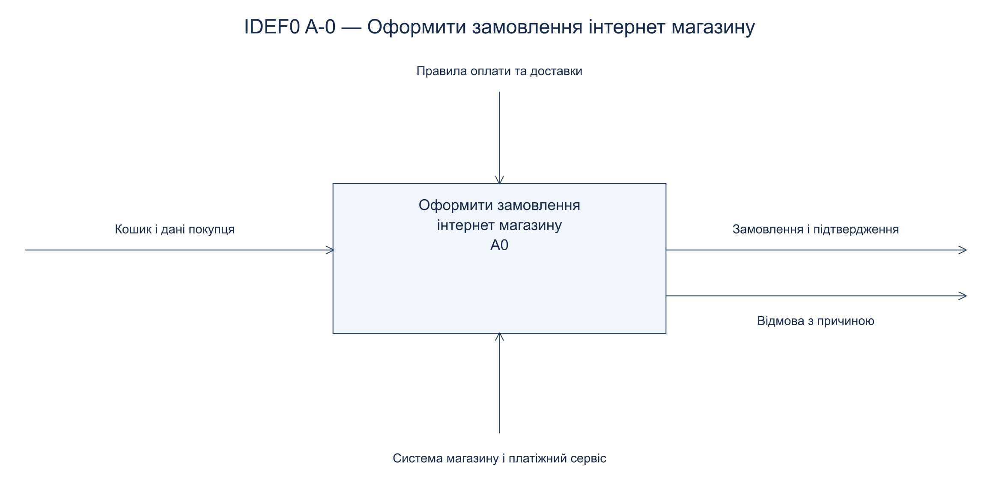
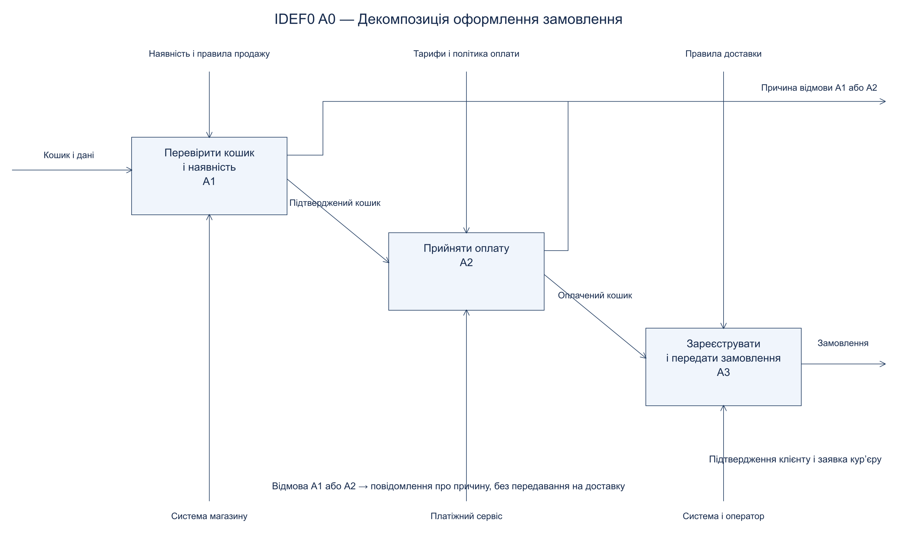

# Практична робота 11-12

## Контекстна модель IDEF0 та декомпозиція

Предмет: Компоненти. Номер у списку: 14.

Обрано варіант 1 — оформлення замовлення в інтернет-магазині. Межі процесу: від передавання кошика й контактних даних до реєстрації замовлення та заявки на доставку.

| ICOM | Зміст |
|---|---|
| Input | Кошик, адреса, контакти та обраний спосіб доставки |
| Control | Правила продажу, оплати, тарифи й умови доставки |
| Output | Зареєстроване замовлення, підтвердження покупцю, заявка кур’єру; при відмові — причина |
| Mechanism | Система магазину, платіжний сервіс, оператор |

A1 перевіряє кількість та резервує наявні товари. Вхід — кошик; управління — правила продажу та відомості про доступність; механізм — система магазину; вихід — підтверджений кошик або відмова.

A2 приймає платіж тільки для підтвердженого кошика. Управління — тарифи та політика оплати; механізм — платіжний сервіс; вихід — результат оплати та оплачений кошик. Невдалий платіж не передається A3; резерв звільняється.

A3 реєструє замовлення за підтвердженим платежем. Управління — правила доставки; механізми — система й оператор. Виходи перетинають межу A0: підтвердження клієнту та заявка кур’єру. Декомпозиція збалансована з A-0: зовнішні входи, управління, механізми та результати мають відповідники. Стрілки IDEF0 позначають залежності й потоки, а не часову послідовність.
