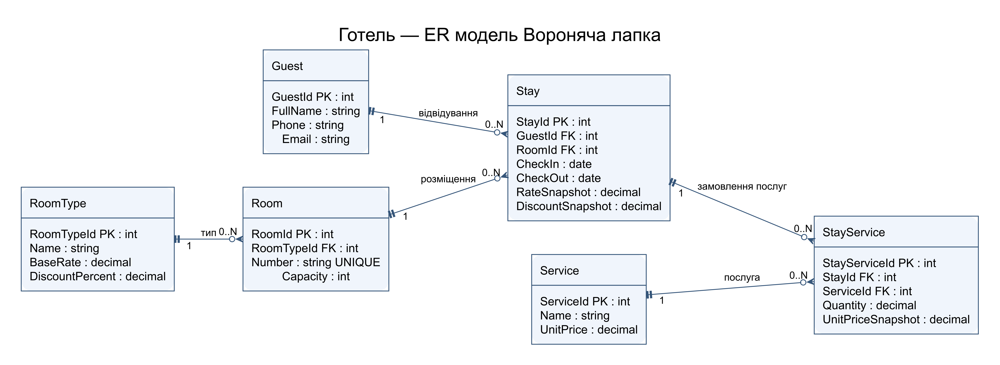

# Практична робота 13

## ER модель готелю у нотації Вороняча лапка

Предмет: Компоненти. Номер у списку: 14.

Система обліковує гостей, типи та фізичні номери, перебування і додаткові послуги. Один запис Stay описує одного основного гостя в одному номері протягом інтервалу [CheckIn, CheckOut). Історію проживань збережено окремо від картки гостя.

RoomType задає базовий тариф і знижку; Room належить одному типу. Guest і Room можуть мати багато перебувань, але кожне перебування має рівно одного основного гостя та номер. StayService розв’язує M:N між Stay і Service: одне перебування може містити багато наданих послуг, одна послуга — фігурувати в багатьох перебуваннях.

Тариф і знижка копіюються в Stay під час заселення, а ціна послуги — у StayService. Зміна довідника не перераховує історичні рахунки. Сума = кількість ночей × RateSnapshot × (1 − DiscountSnapshot/100) + Σ(Quantity × UnitPriceSnapshot). Наприклад, 3 ночі по 1000 грн, знижка 10%, 2 сніданки по 150 грн: 2700 + 300 = 3000 грн.

Обмеження: дата виїзду пізніша за дату заселення; знижка 0–100%; тарифи невід’ємні; кількість послуг додатна; номер кімнати унікальний. Перебування в одному номері не перекриваються. Статус зайнятості обчислюється з дат, а не дублюється в Room. Видалення довідникових записів із чинними посиланнями заборонено.

На стороні батьківського запису стоїть рівно один (||), на стороні дочірніх — нуль або багато (o з воронячою лапкою). Зв’язки неідентифікувальні: дочірні таблиці мають власні PK. Ключі PK та FK позначено явно. Структуру можна відтворити в SQLite командою читання hotel.sql; тригери забороняють перетин дат і при INSERT, і при UPDATE. Модель відповідає 3НФ: довідники відокремлені, а історичні цінові знімки належать конкретній операції.
