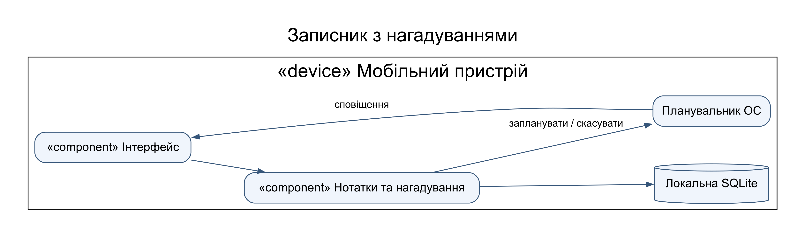
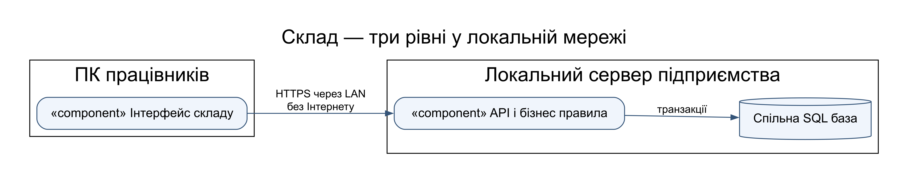
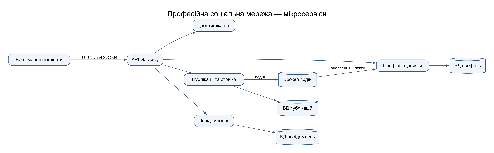

# Практична робота 22-23

## Архітектури трьох програмних продуктів

Предмет: Компоненти. Номер у списку: 14.

### Записник з нагадуваннями

Користувач — власник пристрою. Функції: створення й редагування нотаток, планування події, перегляд справ, скасування нагадування. Обрано локальний модульний моноліт: одна програма з шарами інтерфейсу, логіки та сховища. Це зменшує складність і дає автономну роботу. Нагадування реєструються в планувальнику ОС: таймер лише в пам’яті програми не забезпечує спрацювання після її закриття. Обмеження — фонові дозволи та енергозбереження ОС; після перезапуску звіряється список зареєстрованих подій.

### Облік товарів на складі

Користувачі — комірник, менеджер, адміністратор. Функції: товари, надходження, відвантаження, залишки, звіти. Обрано клієнт-серверну трирівневу систему в локальній мережі. Відсутність Інтернету не означає відсутність LAN: спільний локальний сервер забезпечує єдині залишки декільком працівникам. Списання товару атомарне; не допускається від’ємний залишок. Резервні копії виконуються на окремий носій. За втрати LAN операції запису блокуються з поясненням: автономне незалежне редагування декількох копій без синхронізації створило б конфлікти.

### Профільна соціальна мережа

Користувачі — фахівці, модератори, адміністратори. Функції: профілі, публікації, підписки, стрічка й приватні повідомлення. Для заданого великого навантаження обрано мікросервіси за предметними межами з API Gateway. Окремі БД належать сервісам; події через брокер оновлюють стрічку з допустимою короткою затримкою. Ідентифікатор події дає ідемпотентну повторну обробку. Повідомлення мають перевірку доступу; публічні файли можна винести в об’єктне сховище. Перевага — незалежне масштабування; ціна — мережеві відмови, розподілене спостереження й складніша узгодженість.

### Порівняння

| Продукт | Розгортання | Основний аргумент | Компроміс |
|---|---|---|---|
| Записник | Один пристрій | Один користувач і автономність | Немає синхронізації пристроїв |
| Склад | Клієнти та локальний сервер | Спільні узгоджені дані без Інтернету | Залежність від LAN і сервера |
| Соцмережа | Незалежні мережеві сервіси | Велика кількість користувачів | Складність експлуатації |
