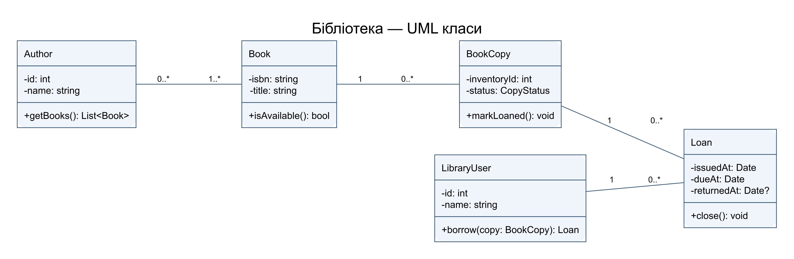
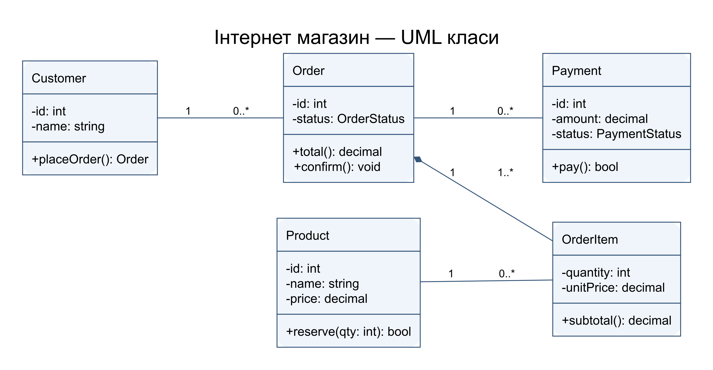
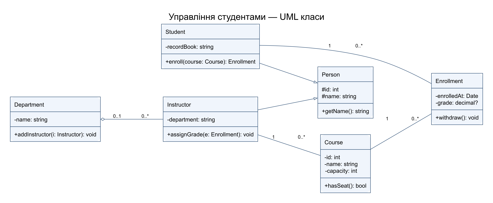

# Практична робота 24

## Три UML діаграми класів

Предмет: Компоненти. Номер у списку: 14.

Виконано всі три частини завдання. В атрибутах і методах вказано типи та видимість: − приватна, # захищена, + публічна. Рядки після розділювача операцій описують поведінку.

### Бібліотека

Book — бібліографічний опис, BookCopy — фізичний примірник. Один опис має багато примірників; один примірник має історію Loan, але одночасно не більше однієї незакритої видачі. Книга має одного чи кількох авторів, автор — нуль або багато книг. LibraryUser пов’язаний із Book через Loan, тому дата повернення не губиться. Loan — історичний запис: видалення гостя чи примірника обмежується, а не каскадно стирає історію.

### Інтернет магазин

Customer створює Order. Order складається з OrderItem: заповнений ромб стоїть біля цілого, OrderItem не має окремого життєвого циклу. Product пов’язаний асоціацією: видалення замовлення не видаляє товар. OrderItem зберігає історичну ціну. Payment має 0..* через можливі повторні спроби; бізнес-правило дозволяє не більше одного завершеного платежу на повну суму.

### Студенти

Student та Instructor успадковують Person; порожній трикутник вказує на базовий клас. Enrollment реалізує зв’язок M:N між студентами й курсами та містить оцінку. Department агрегує викладачів: порожній ромб біля кафедри, викладач може існувати після її реорганізації. Пара Student+Course у межах одного запуску курсу унікальна; місткість перевіряється при реєстрації.

### Самоконтроль

1. Діаграма класів показує статичну структуру та зв’язки типів.
2. Клас, атрибут, операція, асоціація, узагальнення, композиція, агрегація, залежність.
3. Композиція задає залежний життєвий цикл частини, агрегація — незалежний.
4. Видимість визначає, які члени доступні клієнту чи нащадку.
5. Слід підтримувати єдиний рівень абстракції, відповідальність класу, коректні кратності та невисоку зв’язаність.
