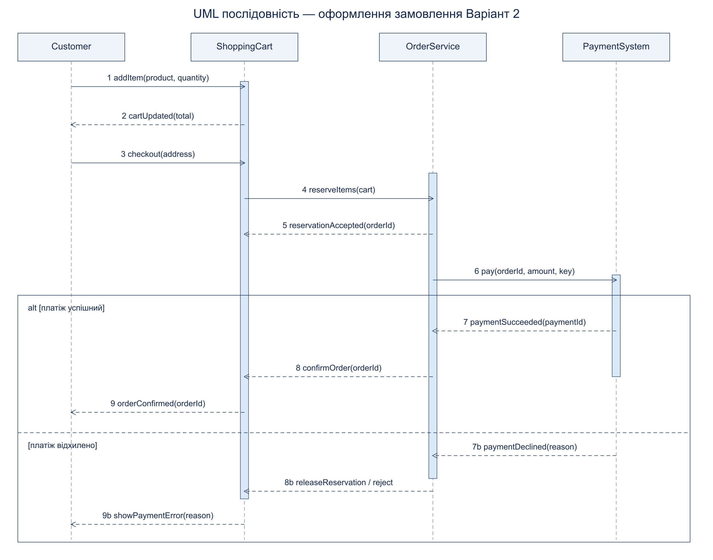

# Практична робота 25

## Діаграма послідовності оформлення замовлення

Предмет: Компоненти. Номер у списку: 14.

Обрано варіант 2. Учасники: Customer, ShoppingCart, OrderService, PaymentSystem. Передумови — кошик не порожній, адреса валідна, товари доступні. OrderService перевіряє та резервує залишки до початку оплати. Відсутність товару завершує сценарій до звернення до PaymentSystem.

Customer додає товар і бачить актуальну суму. Checkout передає кошик серверу, сервер резервує товар і використовує унікальний ключ ідемпотентності платежу. Успішна гілка alt підтверджує замовлення після відповіді платіжної системи. У гілці відмови резерв звільняється, статус залишається неоплаченим, користувач отримує причину. Невизначений результат платежу через тайм-аут потребує перевірки статусу за тим самим ключем, щоб не списати кошти двічі.

Суцільні стрілки — синхронні виклики; пунктирні зворотні стрілки — відповіді. Вертикальні пунктири — життєві лінії; вузькі прямокутники — активації. Об’єкти живуть довше за сценарій, тому штучні позначення знищення X не додані.
