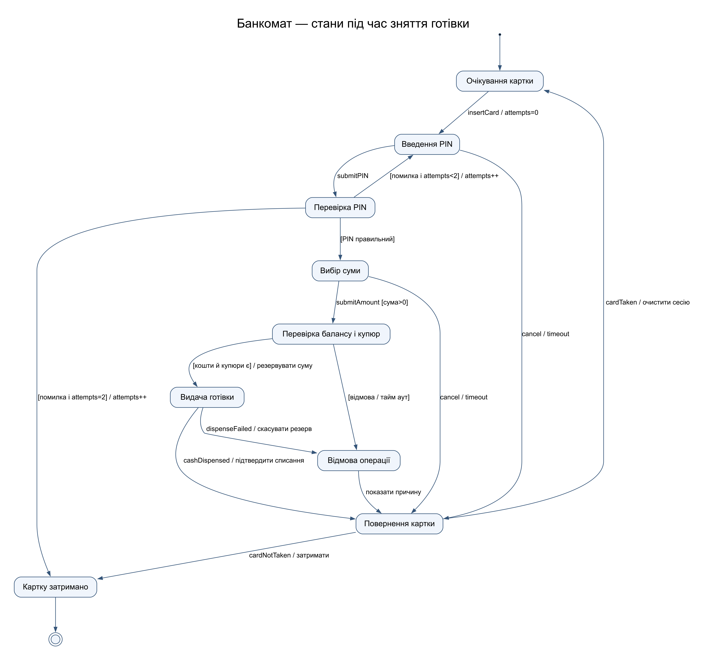
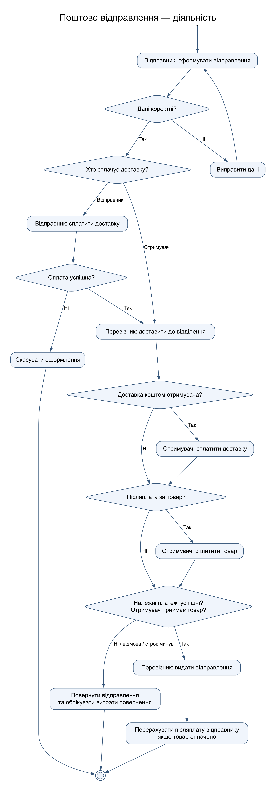

# Практична робота 27

## Діаграми станів банкомата та діяльності поштової служби

Предмет: Компоненти. Номер у списку: 14.

### Стани банкомата

Стан визначає допустимі події. Картка запускає сесію; після двох невдалих спроб дозволено третю, третя невдала спроба затримує картку. Cancellation і тайм-аут повертають картку з екранів PIN та суми. Сума резервується перед видачею; списання підтверджується після фактичної видачі. За збоєм видачі резерв скасовується або передається на звірку, якщо факт видачі невизначений. Повернена, але не забрана картка затримується. Завершення штатної сесії повертає банкомат у очікування.

### Діяльність поштової служби

Модель містить чотири комбінації: доставку сплачує відправник чи отримувач, товар має післяплату чи ні. Доставка й товар є окремими платежами. Якщо доставку оплачує відправник, успішний платіж потрібний до передавання перевізнику. Для оплати отримувачем доставка сплачується перед видачею. Післяплата додається незалежно від платника доставки. Без усіх належних платежів відправлення не видається; відмова чи прострочення отримання спричиняє повернення. Кошти за товар перераховуються відправнику тільки після успішного приймання. Умовний текст на діях визначає відповідального учасника.
